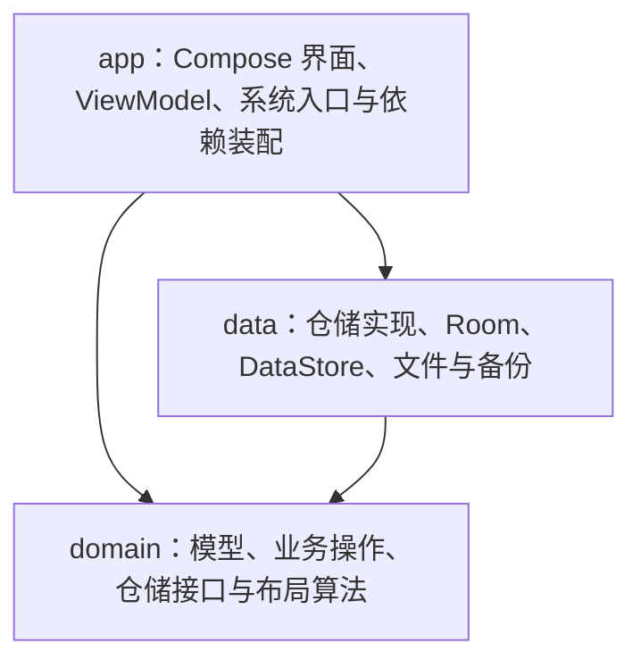
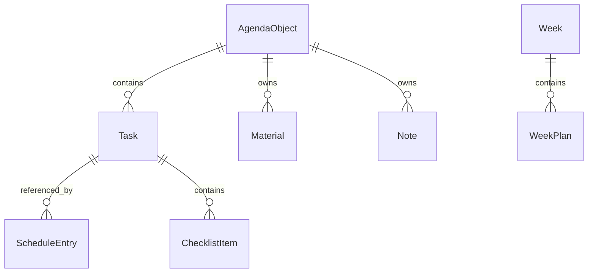
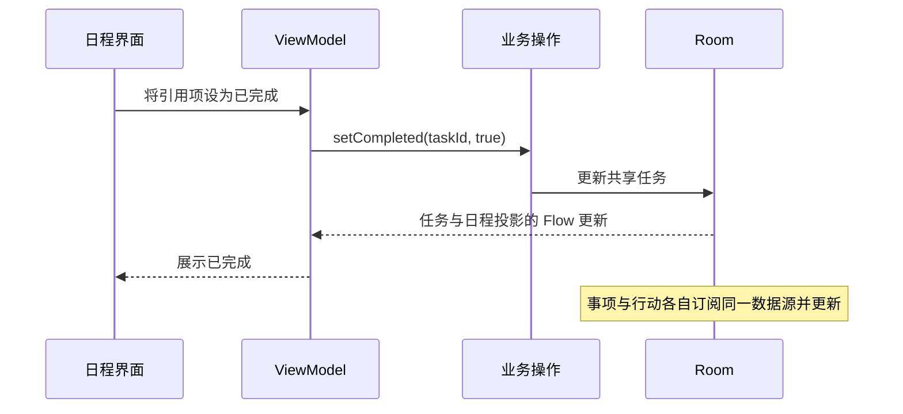

# Agenda 技术架构设计 v1

日期：2026-10-20。状态：技术实现方案；用户已表示基本无问题。已建立 Android 三模块骨架与内存动效样机，真机性能及完整生产功能尚未验证；实施证据见《Android动效样机阶段计划》。

2026-10-29 实施更新：当前 0.11.0，Room schema v6 与备份格式 v3；任务说明及材料关联已实现，并纳入删除恢复集、备份校验与整库切换，旧 v1/v2 备份继续兼容。Android 12、页面恢复和文档对照首轮验证结果见《文档对照与发布检查-0.11.0》。下文早期阶段状态按历史背景阅读。

产品选择依据：[技术架构决策记录](技术架构决策记录.md) D01–D22。视觉依据：[整体视觉设计规范](整体视觉设计规范.md)。既有行为依据：[关键状态与验收说明](关键状态与验收说明.md)。旧需求与本轮已确认决定冲突时，以决策记录为准。

## 1. 总体方案

Android 12 起；Kotlin + Jetpack Compose；Room 保存业务数据；DataStore 保存少量偏好；协程与 Flow 传递异步结果和可观察状态；应用内部文件保存材料与自定义背景。无账号、服务端、云同步、系统通知和独立分类板块。

采用三个 Gradle 构建模块。图中箭头表示编译依赖，不表示数据库更新必须由界面逐层广播。

- `:app` 只在装配入口连接 `:data` 的具体实现；页面与 ViewModel 面向 `:domain` 接口，不直接操作 DAO 或文件路径。
- `:domain` 为 Kotlin 模块，可使用协程，不依赖 Compose、Android Context、Room 注解或 Android URI 类型。
- `:data` 为 Android 库模块，实现接口与跨数据库、文件的协调操作，不依赖界面。
- 先手动装配依赖，不为第一版额外引入依赖注入框架；如后续复杂度增长再评估。

## 2. 功能组织与共享规则

| 功能包 | 职责 | 边界 |
| --- | --- | --- |
| things | 对象、任务、材料、说明的展示与编辑；关系图和任务板 | 两种视图读取相同数据，不各自保存任务副本 |
| action | 按执行类别查看未完成任务、休闲活动；四卡下方新增「尽快做」，按期限显示一周内最紧急的最多三个任务 | 类别与尽快做共用任务数据和完成操作；尽快做是派生视图，不是新类别 |
| schedule | 悬挂卡片、完整日期流、日程增改及独立周清单 | 引用项读取原任务完成状态；临时项和周清单独立完成 |
| search | 搜索对象、任务、材料名、说明并返回定位目标 | 只返回稳定实体 ID 与定位信息，不持有页面实例 |
| reminder | 本地每日检查、去重、日期变化和编辑避让 | 不自行弹框；由界面在合适时机展示结果 |
| backup | 完整导出、校验、整库恢复和恢复前快照 | 对业务写入和文件操作协调，不把替换任务交给页面执行 |
| design / motion | 设计令牌、字体、图标、材质和可中断动效 | 不包含业务存储；特殊玻璃渲染实现可替换 |

这些是包及职责划分，不额外增加 Gradle 模块。事项、行动、日程通过共享任务仓储协作，不互相调用页面。

## 3. 数据模型

下图给出核心业务关系；附件与任务的关联表、布局与运行状态等辅助记录见后文。

`Task.objectId` 可空，因此任务可以独立存在；`ScheduleEntry.taskId` 可空，因此日程可以是临时项。Week 是由周一起始日期标识的逻辑分组，不强制建立单独表。

| 实体 | 主要字段及约束 |
| --- | --- |
| AgendaObject | 稳定 ID、名称；本身无完成状态 |
| Task | 稳定 ID、可空 objectId、名称、完成状态、可空执行类别、想做/该做两个独立布尔值、可空截止日期、说明 |
| ChecklistItem | 早期预留构想；2026-10-29 用户明确延后，第一版不建立此表或提供内部子清单 |
| Material | ID、objectId、原文件名、可选显示标题、文字说明、MIME、内部文件标识、大小及完整性信息；内部标识不使用绝对路径作为导出引用；外部优先显示标题，留空回退原文件名 |
| TaskMaterialLink | taskId、materialId 复合主键与双向外键；关联已有材料，共用副本，独立任务也可选择已有材料。移动任务不改变关联，删除材料解除关联，撤销成组恢复；不新增独立任务上传自有材料入口 |
| Note | ID、objectId、标题、正文 |
| ScheduleEntry | ID、本地日期、上午/中午/下午/晚上、可空本地时间、可空 taskId、可空显示名称、临时项名称和完成状态 |
| WeekPlan | ID、weekStartDate（周一）、内容、独立完成状态、显示位置；历史周保留 |
| LeisureActivity | ID、内容、显示位置 |
| BoardPlacement | 顶层事项 ID、布局版本、归一化空间位置等；保存空间位置，不仅保存业务排序号 |
| ScheduleAppearance | 背景颜色、可空背景文件标识、文字；与业务数据一起备份 |
| ReminderCheck | 已自动检查的本地日期；保持既定每日去重规则 |

技术方案：实体 ID 使用 UUID；枚举存稳定代码，不存中文界面文本。Room 保存实体、关联、空间布局和需要与业务一起一致备份的配置；DataStore 保存视图模式等轻量偏好。手势坐标、拖动中间态、动画进度只放内存。

关键约束：

1. 引用日程的显示名为“单独显示名称（若有），否则任务当前名称”。清空覆盖名称即恢复跟随，不修改任务名称。
2. 引用日程不独立存一份可编辑完成状态；通过查询投影任务状态。临时日程的完成状态由自身管理。
3. 相同任务、日期、时段、具体时间不得重复引用；空时间规范化后参与判重，不能仅依赖可空字段的唯一索引行为。
4. 修改显示名称不绕过重复引用限制；改名不影响身份、材料关联和日程引用。
5. 删除对象时处理当前所属任务、材料、说明、相关任务材料关联和引用日程；删除任务不误删所属对象的共享材料。
6. 截止日期与日程日期为本地日历日期；日程时间为可选钟点。切时区不换算，今天按设备本地日期刷新。
7. 搜索结果、布局锚点或打开中的详情遇到实体被删除时，安全清除定位状态并给出反馈。

## 4. 模块接口契约草案

以下为职责级接口，具体 Kotlin 类型和方法签名在工程建立时细化。查询返回 Flow，写入使用 suspend 并返回可区分的成功或错误结果。

| 接口 | 查询 / 操作 | 必须保证 |
| --- | --- | --- |
| ThingsRepository | 观察对象与任务；创建、编辑、移动归属；设置类别 | 名称必填；对象无完成态；移动保留 ID |
| TaskCompletion | setCompleted(taskId, completed) | 事项、行动及所有引用日程观察同一任务状态；使用明确目标状态，避免重复点击反转错误 |
| UrgentTasksPolicy / TaskQueries | observeUrgentTasks(localDate, limit = 3) | 从共享任务按截止日期升序派生最多三项；日期变化切换查询条件，任务变化通过 Flow 更新；日期边界与逾期规则按产品需求第 3.4 节建议核对后实现，不复用三天每日提醒过滤器 |
| ScheduleRepository | 按日期范围观察；添加/编辑引用项与临时项；设置完成 | 检查任务存在、判重；引用项完成路由到任务操作 |
| WeekPlanRepository | 按周观察、添加、编辑、设置完成 | 固定周一；独立添加入口；独立数据与完成态；不写入 Task 或 ScheduleEntry，不参与事项/行动/尽快做；切周不覆盖历史 |
| MaterialRepository | 导入材料、观察/编辑元数据、加载图片预览、申请打开、移除材料 | 改标题/说明不改 UUID、原文件名与副本内容；图片内部打开并限制预览解码尺寸；复制成功才发布条目；失败不留假条目；对外不暴露私有真实路径 |
| SearchRepository | search(query) | 覆盖既定四类内容；返回类型、ID 和所属上下文；第一版不搜索附件正文 |
| ReminderPolicy / ReminderRepository | 计算近三天候选；取得/标记检查日期 | 可注入时钟；排除今天、逾期、完成和无期限；空结果也记已检查；编辑中延后 |
| DeleteCoordinator | previewDelete(target)、delete(plan)、undo(token) | 预览列明数量；执行时再次检查影响范围变化；删除与撤销按整个操作处理 |
| BackupCoordinator | export、validate、restore | 完整包、一致快照、先备份当前数据、失败保留原数据 |
| LayoutStore / LayoutEngine | 保存空间位置；根据内容与视口计算布局 | 持久位置与动画状态分离；节点增量布局稳定；不同宽度下有位置恢复策略 |

界面处理 ValidationError、NotFound、DuplicateSchedule、StorageFull、FileUnavailable、UnsupportedBackup、CorruptBackup 等明确错误，不将底层异常字符串直接展示给用户。保存失败保留输入并提供重试，不先显示保存成功。

2026-10-29 编辑实现：现阶段由 AgendaRepository 暴露 updateTask、renameObject、updateNote、updateSchedule、updateWeeklyPlan，全部按原 ID 在事务内更新并发布统一快照，不用插入替换。任务编辑读取事务内最新完成态，改归属只改 task.objectId；日程编辑判重排除自身，冲突回滚。修改引用来源不改变原任务；转为临时项时保存当时有效完成态，转为引用时读取目标任务状态。数据库结构仍为 v3，无须为增加编辑操作变更 schema。

2026-10-20 行动页新增范围：原四卡下方的「尽快做」复用任务投影，不新增数据库表、持久榜单、系统通知或 Gradle 模块。第一版可按完成状态与截止日期建立查询索引；同日任务用稳定 ID 打破并列。任务改期、完成、删除/撤销和本地跨日后重算。日期参数与任务数据都必须是可观察输入，不能只在页面首次打开时计算。具体边界、空态及并列规则仍按产品需求第 3.4 节区分已确认与实现建议。独立「deadline」页面不在当前范围。

## 5. 完成同步数据流

不通过“日程通知事项页面”的链式回调同步。UI 状态区分已提交数据、编辑草稿与保存中；旋转或后台返回不应凭内存重复提交。

## 6. 删除与短暂撤销

技术方案：删除立即对活动查询隐藏，使用持久操作记录暂存完整恢复集，并延迟清理附件；撤销恢复同一组实体与引用。技术暂存不向用户提供回收站入口。

0.8.0 已实现：DeletionRepository / RoomDeletionRepository 在同一数据库事务中写入版本化恢复集并移除活动记录，撤销按父实体 → 子实体 → 引用顺序插回原 ID；任一约束冲突则全部回退。schema v4 新增操作记录表；文件回收同时读取活动材料与暂存恢复集，保留撤销期内副本。默认 8 秒，读取 AccessibilityManager 推荐时长并持久记录实际截止；进程重启不重新计满窗口。具体证据见《删除与短暂撤销-0.8.0》。

- 删除前显示影响数量；若确认期间关联内容变化，更新预览后再确认。
- 0.8.0 撤销窗口以 8 秒为默认基线，并遵守系统辅助功能建议时长；作为可调整交互参数实现，确认框显示实际时长。
- 应用内部导航不应立即让撤销失效；连续删除以独立操作记录和明确 token 处理，不用全局单个备份变量。
- 窗口到期后逻辑删除确定；附件清理可稍后完成，不影响对用户已结束的恢复边界。
- 进程中断后按持久操作状态恢复：未到期且仍有效的撤销恢复提示；到期则继续清理。0.8.0 使用持久绝对截止时间，进入后台或重启不暂停、不重置窗口，时间回拨到操作创建前则保守结束。
- 撤销前确认所属对象等依赖仍有效；有后续删除冲突时明确返回失败原因，不能恢复出悬空关系。
- 导出备份前结束待撤销操作，并在有活动撤销时告知用户该边界；备份不携带短暂恢复集。此为技术方案中的交互提案，实施前核对。

## 7. 材料与备份恢复

材料先写暂存文件，复制并校验成功后登记元数据；失败清理暂存。文件名不是唯一身份。显示标题与说明作为元数据单独编辑，不改原文件名、文件标识、字节或摘要。图片使用应用内查看器，在 IO 线程从私有副本解码最长边最多 2048px 的预览，按图片方向显示；支持缩放、拖动、复位及失败重试。其他类型通过系统查看工具打开只读授权内容；没有可用工具时提示安装查看器或稍后重试，不自建 PDF/PPT 阅读器。应用文件缺失与无查看器分开反馈。后续完整备份需一并导出材料标题和说明。

完整备份建议为带清单的 ZIP：包含格式版本、逻辑记录、附件与背景、设置及布局、文件大小和摘要。导出逻辑记录而非直接复制运行中的 SQLite 主文件。数据库 schema 版本与备份格式版本分别管理。

0.9.0 实现当前数据的 ZIP 格式 v1、SHA-256/CRC/关联和范围校验、恢复前最近三份完整快照、空间检查与版本拒绝。LocalDataGate 冻结一致导出并拦截已停用数据集的旧写入；WorkspaceManager 使用 AtomicFile 指针发布已构建的新数据集，记录上一代与待确认状态，启动时验证或回退。设置为每代独立 DataStore，先写设置种子、激活时初始化，保存状态以数据集 ID 隔离；材料提供器支持受管代目录。

0.10.0 增补：数据库显式迁移 v4 → v5；DailyFeatureRepository 管理每日检查去重、休闲活动与任务板双列空间格位，VisualAssetStore 管理背景图片内部副本及原子配置保存。格位允许留白，不作为业务排序；动画中间状态不入库。日程背景及文字保存在 Room，每代 assets 目录与材料目录一同验证、发布；备份格式 v2 包含全部新增记录及背景文件，兼容 v1。每日提醒按本地自然日检查明天起三个自然日，空结果也去重；编辑及备份期间延后，无后台通知。实现及验证见《日常功能补齐-0.10.0》。

恢复步骤：

1. 将备份读入独立暂存区域；校验格式版本、记录结构、引用完整性、文件清单与摘要，限制解包总量并阻止路径越界。
2. 暂停写入及新文件操作，完成或阻止并发保存；在一致视图上生成恢复前完整快照，失败即停止。
3. 构建并验证新的数据库、附件目录与设置快照，保持原活动数据不变。
4. 使用持久指针记录阶段，发布完整新数据集并停用旧写入，随后重建服务并关闭旧句柄；不对运行中的库和附件逐个原地替换。多个文件的切换不是一次数据库事务，必须设计重启恢复。
5. 成功后重建订阅和页面定位；失败回退原数据库、文件与设置。启动时检测中断记录，完成回退或已提交的切换。

保留恢复前快照至少直到新数据成功启动并通过校验；快照保留数量及清理入口在备份功能实施时给出具体交互方案。备份可能很大，导出与恢复均检查空间并显示进度；退出或进程中断不得造成原库被半覆盖。

## 8. 动效样机与验收

样机使用同一原生工程和独立演示数据入口，避免先制作一个以后全部废弃的网页样机。初期不接正式数据库，模拟接口只提供必要演示状态；复杂绘制与业务不耦合。

| 样机 | 重点验证 |
| --- | --- |
| 任务板 | 卡片宽高联动、邻卡挤压与纵向让位；长文字；轻点/滚动/长按区分；中途再次操作 |
| 日计划 | 悬挂展开挤开两侧；完整日期流吸附；横向滑动与内容操作冲突 |
| 关系画布 | 有界平移、双指缩放、强阻尼回弹、局部聚焦；新增节点稳定性 |
| 玻璃与混排 | 背景模糊而浮层内容清晰；不同底图和面板尺寸；四种字体分工、字形和数字对齐 |
| 行动页新增卡片 | 在原四卡下加入「尽快做」，验证长名称、0–3 项、滚动及底部导航遮挡；遵循既有视觉风格，不重排原四卡 |

Compose 常规动画与自定义 Layout/Canvas 组合实现；背景采样和模糊独立封装，原生能力或额外依赖在样机中评估，未验证前不承诺效果与成本。动效必须可中断并从当前状态继续，不锁住输入等待播放完毕。

性能方案：主设备按实际启用的刷新率记录帧耗时和卡顿，60Hz 每帧预算约 16.7ms、120Hz 约 8.3ms；不是预先宣称达到这些指标。使用可分析的接近发布构建测量，不以调试版目测作为性能结论。覆盖长内容、键盘、连续操作和较多节点；数据规模在样机测量时记录。支持减少动画及系统字体缩放。若需明显降低玻璃或动效保真度，提交对比供用户选择。

主验收机：红米 Note 14 Pro+，Android 16（用户提供，接入时核实），刷新率待确认。另需 Android 12 兼容验证，模拟器不能替代主机手感和 GPU 性能验收。

## 9. 实施阶段

1. 环境与工程骨架：核对 Android Studio/SDK/JDK；建立三个模块、Gradle Wrapper、统一依赖版本和演示构建入口。compile/target SDK 与库版本在开工时按官方稳定兼容组合锁定，不与最低 Android 版本混淆。
2. 动效与手势样机：按上表交付可安装调试包、交互记录及真机问题清单，由用户验收效果。
3. 第一条完整流程：创建任务 → 添加任务引用日程 → 从日程完成 → 事项/行动同步 → 重启保留；接入 Room、迁移与错误处理。
4. 完成范围：对象、材料、说明、周计划、搜索、每日提醒、行动页「尽快做」、布局保存、删除撤销、完整备份恢复；独立「deadline」页面不纳入。
5. 发布前验证：数据库迁移；关联删除撤销；恢复中断、损坏与空间不足；最低系统兼容；性能和视觉回归。调试 APK 不作为正式发布包，正式签名和分发另行处理。

验证重点为业务约束与真实故障边界，不为简单视觉样式编写镜像测试。现有浏览器测试仅作为规则参考，不替代 Android 测试。生产首次启动不自动导入原型演示数据；样机演示入口与正式用户数据隔离，此为工程提案。

## 10. 协作方式与环境检查

用户在 Codex 中确认方案与效果；代码、构建配置、命令行测试由助手负责。Android Studio 用于 SDK 管理、模拟器、预览与性能分析，通常不必全程开启；准备好 SDK、兼容 JDK 和项目 Wrapper 后可命令行构建与安装。

手机的开发者选项、USB 调试、电脑授权，以及触感/视觉验收需要用户在真机参与。无线调试可后续选择，初次连接建议 USB。

本次只读检查：Java 命令存在；adb、gradle、sdkmanager 不在 PATH；标准 Android SDK 与 Android Studio 目录未发现；ANDROID_HOME、JAVA_HOME 未设置。这不是完整安装盘扫描，不能据此断言未安装；独立 Gradle 命令也不是必需，工程将使用 Wrapper。尚未安装或修改系统工具。

后续定位结果（用户提示 D 盘目录后）：Android Studio 位于 `D:/allAboutCoding/android studio`，版本标识为 `AndroidStudio2025.2.2`；自带 JBR/JDK 21.0.8 可运行。Studio 配置指向 `D:/allAboutAppCache/Android/sdk`，该 SDK 目录存在，内含 platform-tools、platforms、build-tools 与 emulator；已验证 adb 36.0.2 可通过绝对路径运行。用户 Gradle Wrapper 缓存中存在 `gradle-8.13-bin`。此前标准路径未发现不代表缺少环境，无需据此重装。具体构建版本组合与首次构建仍待验证，未修改全局环境变量。

参考：[Android 命令行构建](https://developer.android.com/build/building-cmdline)、[真机运行](https://developer.android.com/studio/run/device)、[Compose 自定义布局](https://developer.android.com/develop/ui/compose/layouts/custom)、[Room](https://developer.android.com/training/data-storage/room)、[数据库迁移](https://developer.android.com/training/data-storage/room/migrating-db-versions)。
