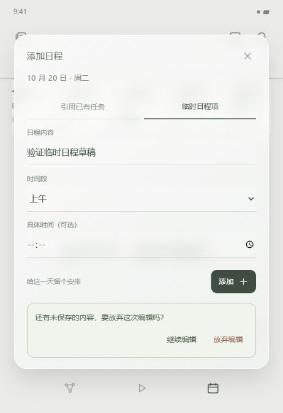

# Agenda Android 交互原型

这是根据 `documents/产品需求与设计决策.md`、`documents/页面架构 v1.png` 与 `documents/低保真原型改版说明.md` 制作的浏览器原型。默认进入事项关系视图，主内容铺满整个屏幕；顶部与底部导航只显示图标，不使用圆形底板。直接点击底部图标立即切换页面；点击底部导航条的空白处，会增强三个图标的显示，点击主内容或切换页面后恢复低对比度。关系视图的概览图标位于左下方，新增图标位于右下方。

## 打开

在项目根目录运行：

```powershell
python -m http.server 8765
```

用浏览器打开 `http://localhost:8765/prototype/`。建议用 Android 手机浏览器，或桌面浏览器的手机视口查看。数据保存在当前浏览器的 `localStorage` 中。

## 可验证的流程

- **事项**：关系图平移、双指或滚轮缩放、越界阻尼回弹、对象和分支原位展开、全局概览；左上角翻牌切换双列任务板。任务板轻点展开、正常纵向滚动、长按拖动卡片位置。
- **创建与材料**：点击事项页右下角图标会在画布上展开半透明玻璃质感的轻量任务浮层；只填名称即可创建，也可直接选择随手做、轻量做或专注做。“归属、日期、意愿”始终是展开与收起入口，已选内容单独显示在下方。右上角可切换同款轻量对象浮层，切换时保留已输入的名称；对象也只需填写名称。展开对象卡片后可添加材料和说明。当前会话添加的真实文件可以从原型中打开。
- **行动**：随手做、轻量做、专注做和休闲活动以双列矩形卡片呈现，直接显示内容摘要；轻点卡片在原位展开任务。任务分类操作仍在讨论，行动页暂不显示独立分类区。
- **日程**：左上角用一个纯图标按钮切换悬挂日期卡片与完整日期卡片流，不显示文字选项。两种视图均从屏幕高度约 19% 处开始；日期卡片可横向浏览。悬挂卡片默认收起，点击日期原位展开；收起时，中间留白显示可编辑的文字。日程可以引用已有任务或创建临时日程项；完成引用日程会同步完成原任务。
- **周计划**：点击右上角图标，在日程上方展开小视图；支持添加和完成，不要求选择周几。
- **完成状态**：日程两种视图、周计划、行动卡片与任务板中的事项统一使用左侧小方格；点击方格勾选或取消完成。
- **浮层**：三天提醒、休闲活动、添加日程与其他详情共用半透明玻璃面板、细线输入和轻量按钮。搜索从顶部展开，结果在面板内滚动；点击外部或关闭图标可收起。
- **其他**：全局搜索对象、任务、材料和说明；每日首次进入时显示明天起三个自然日内截止的任务；日计划可编辑背景颜色、上传背景图片和写一两句文字。

## 原型边界

2026-10-20 新增但尚未实现：行动页原四张卡片下增加「尽快做」，按截止日期自动显示一周内最紧急的最多三个任务。需求及日期边界建议见 [产品需求与设计决策第 3.4 节](../documents/产品需求与设计决策.md)，待实现验收见 [关键状态与验收说明](../documents/关键状态与验收说明.md)。当前代码与截图仍为原四卡版本；独立「deadline」页面不纳入第一版。

这是交互验证用的网页，不是 Android 安装包。图节点采用稳定的规则布局；复杂拥挤情况下的自动避让、动画曲线和长按手势参数仍需在手机样机中调试。演示材料只有文件名；用户新选文件的内容只在当前浏览器会话中可打开，刷新后仅保留文件名。周计划及任务数据保存在本机浏览器，不提供跨设备同步。

## 关键状态（2026-10-20）

已补充事项/周计划空状态、行动全部完成、无任务可引用、表单错误、重复安排、未保存关闭保护、图片保存中与失败、材料失效重连、保存失败重试与损坏数据保护，以及跨日提醒。

详细规则、原型边界和验收表见 [关键状态与验收说明](../documents/关键状态与验收说明.md)。

运行自动检查：

```powershell
node prototype/tests/key-states.test.cjs
```

状态预览：



## 视觉风格候选

[打开三套视觉方案](./visual-directions/index.html)：雾青玻璃、纸页手账、夜航深色。包含日程、事项、行动预览及配色、字体、图标和组件规则。当前仅用于比较，未替换正式原型。

## 视觉第二轮

[融合字体、玻璃浮层与两套配色](./visual-refinement/index.html)：暖纸融合修订 / 月白墨蓝。英文 Space Grotesk，数字 Manrope，中文沿用纸页；新增日程、搜索、周计划共享玻璃效果。
